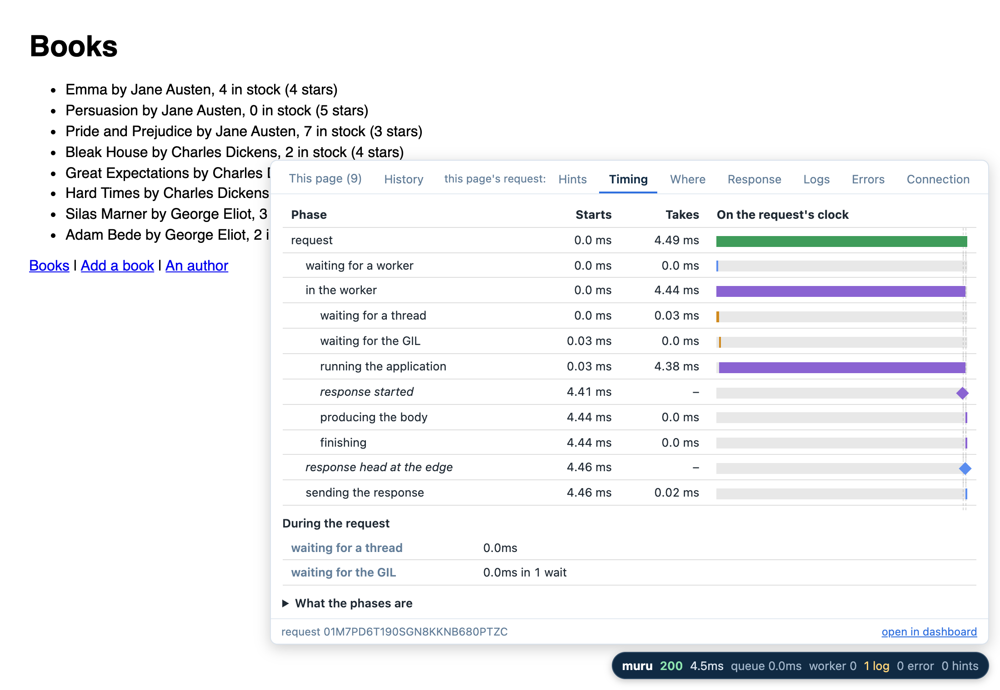
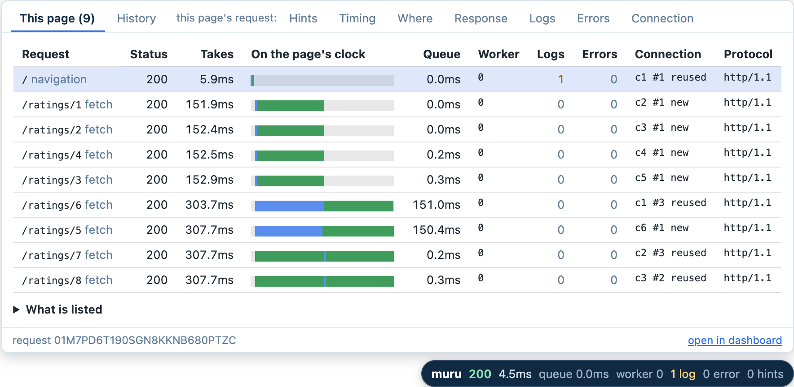
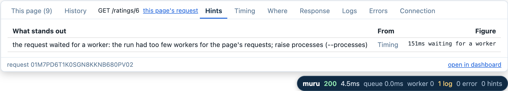
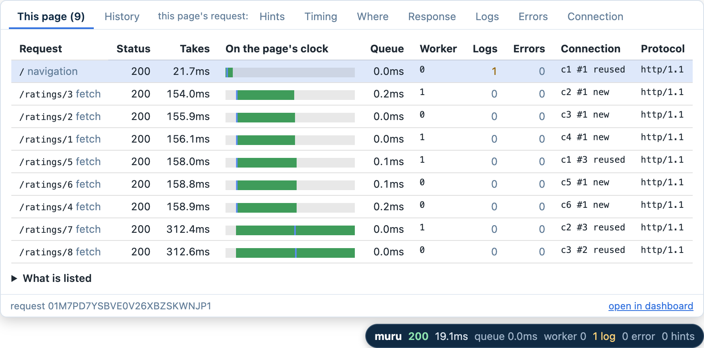
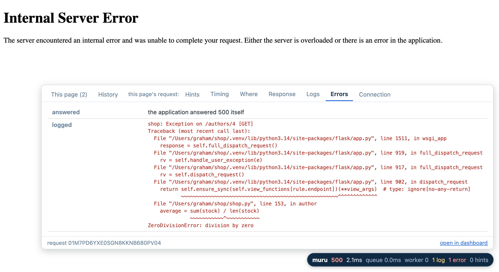
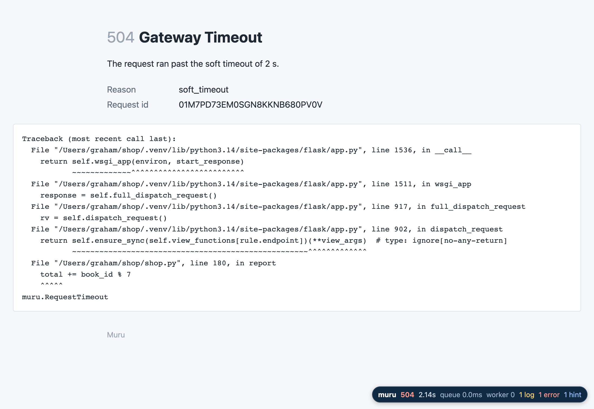
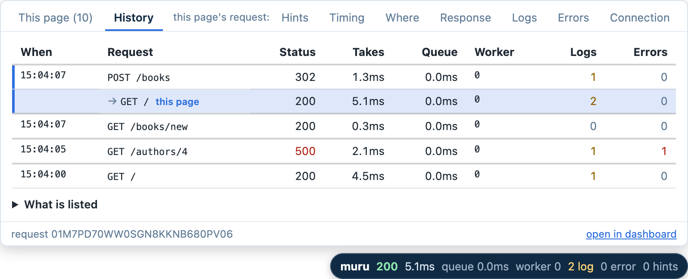

The [looking inside the workers](/posts/2026/11/muru-looking-inside-the-workers/) post was about what a development run is doing right now, with the stacks of its threads, a profile of where the time goes, and a dashboard. What it didn't answer well is a question I find myself asking more often when working on a web application, which is what happened to the one request that produced the page I'm looking at.

Python web frameworks have had an answer to that for a long time. [Django Debug Toolbar](https://django-debug-toolbar.readthedocs.io/) and [Flask-DebugToolbar](https://flask-debugtoolbar.readthedocs.io/) add a panel to each page with the request's timings, SQL queries, logging and more. Both are middleware installed into the application, each works for its own framework only, and both only see what happens once the request reaches the framework.

Muru has a development toolbar of its own. It needs nothing installed into the application, works the same for any WSGI or ASGI application, and because it is Muru that keeps each request's record, it can say things a framework can't, such as how long a request waited for a worker before the application saw it.

## A shop to look at

To have something to look at, I wrote a small Flask shop. Its front page lists books, with the author of each and how many are in stock, which it asks a separate stock service about. The stock service is part of the same application here, at `/stock/`, so nothing else needs to be running. There is also a page for each author, a form for adding a book, a slow report, and a JSON API.

The front page also shows a rating for each book, which a script in the page fetches once the list has loaded:

```html
<script>
for (const span of document.querySelectorAll(".rating")) {
  fetch(`/ratings/${span.dataset.book}`)
    .then((response) => response.json())
    .then((rating) => { span.textContent = `(${rating.stars} stars)`; });
}
</script>
```

Each rating takes about 150 milliseconds, as if it were asking a reviews service. The project's `pyproject.toml` names the application, and gives requests a soft timeout of two seconds, which comes up later:

```toml
[tool.muru]
entrypoint = "shop:app"

[tool.muru.timeouts]
soft_timeout = "2s"
```

## Timings without a toolbar

Even before turning the toolbar on, every response from `muructl run` says how long it took:

```
$ curl -s -D - -o /dev/null http://127.0.0.1:8080/
HTTP/1.1 200 OK
content-type: text/html; charset=utf-8
server: muru
x-request-id: 01M7PA2AG3CBFFQTR4TP0SC0S6
server-timing: queue;dur=0.00, app;dur=4.56, muru;desc="01M7PA2AG3CBFFQTR4TP0SC0S6"
muru-request-link: http://127.0.0.1:8081/request/01M7PA2AG3CBFFQTR4TP0SC0S6
transfer-encoding: chunked
```

`Server-Timing` is a standard header, and the browser's developer tools already know what to do with it. In Chrome or Firefox, selecting a request in the Network tab and opening its Timing section shows `queue`, how long the request waited for a worker, and `app`, how long the application took to produce the response head, in milliseconds. The `muru` entry is the request's ID, the same as in `X-Request-ID` and the access log. `Muru-Request-Link` is the address of the request's page on the run's dashboard, which shows everything Muru kept about it.

The first request in a worker to load modules it hadn't imported yet also gets an `import` entry, saying how long that took. That is a topic of its own, which I'll come back to in another post.

## Turning the toolbar on

The toolbar is turned on with `--toolbar`:

```
$ muructl run --toolbar
...
muru: serving shop:app on http://127.0.0.1:8080 with 1 worker of 4 threads
muru: development mode: error pages show tracebacks, nothing is persisted, the run reloads on change and only loopback is served; production runs under the daemon (muructl daemon start)
muru: toolbar on: the edge inserts it into HTML pages, with each request's record under /_muru/
muru: dashboard on http://127.0.0.1:8081/
```

For it to be on for every run of a project, `toolbar = true` goes in the `[tool.muru.run]` table of `pyproject.toml`. If it is only me who wants it, the same key in the `[run]` table of a `muru.local.toml` beside the project turns it on for my own checkout, without changing what is committed.

Each HTML page then has a badge in its bottom right corner, with the request's status, its total time, the time it waited for a worker, the worker that served it, and how many log records, errors and hints it had. Clicking the badge opens the record:



The application isn't changed in any way. Muru's edge inserts one `<script>` tag before the page's `</body>`, and the toolbar loads from `/_muru/` on the application's own address, which Muru answers without the request reaching the application. Only pages a browser loads as a document get the tag, so responses to `fetch()` calls and htmx requests are left alone, as is anything that isn't HTML or that the application compressed itself. If the page has a content security policy that gives scripts a nonce, the tag is given the same nonce.

The toolbar is also strictly a development feature. Under `muructl serve` and the Muru daemon there is no toolbar, responses carry neither header, and no records are kept.

## What the record holds

The Timing panel above breaks the request into its phases, each with a bar placed where it falls on the request's clock. It starts with how long the request waited for a worker, then what the worker reports itself, which is waiting for a thread, waiting for the GIL, running the application up to the point where it called `start_response()`, producing the body and finishing. Last is sending the response back to the client. A table under the phases adds what can't be placed on the clock, such as how many times the request had to wait for the GIL, and any garbage collections that ran while it was in the worker, since a collection pauses every thread of the worker.

Nearly all of the front page's time is spent running the application, which is what you would hope for, but the record can't yet say what the application was doing in that time. That is what the next post is about.

The other panels have the rest of what Muru knows about the request. Where says which release, worker and thread served it and which client class it was put in. Response has the headers as they arrived and as they were sent, and whether the response was compressed, or why not. Connection says which connection it came on and its position on it. Logs has the log records the application made while serving the request. The front page logs a warning for any book that is out of stock, so its Logs panel has:

```
3.5ms  WARNING  shop  Persuasion is out of stock
```

Muru knows which request a log record belongs to because it was made in that request's thread or task. Output from `print()` isn't kept, since nothing ties it to a request.

## Every request the page made

The front page isn't one request. Once it has loaded, its script asks for eight ratings. The toolbar's "This page" tab lists every request the page made, with the browser's own timings, matched to Muru's record of each through the request ID in its `Server-Timing` header:



The ratings start together, but only four of them were served straight away. The run has one worker with four threads, so the fifth and sixth waited for one of the first four to finish, which shows as a blue bar and about 150 milliseconds under Queue. The last two also took twice as long, but they waited in the browser, not at Muru. A browser opens at most six connections to one host over HTTP/1.1, and they had to wait for one of those to be free.

Clicking a row opens that request's own record. For one of the two which waited, the toolbar's Hints panel says what stands out:



Hints read the record and point at what is worth a look, each saying which panel and figure it comes from. Others cover a long wait for a thread, garbage collection that took a large share of the request, and a response of HTML or JSON that went out uncompressed. The badge counts a page's hints, and the toolbar opens on the Hints panel when there are any.

Taking the hint, I started the run again with `--processes 2`:



None of the ratings waited for a worker this time, and the Worker column shows them shared between the two workers. The last two still waited on the browser's six connections, which is something no number of workers will fix.

This is one place where Muru keeping the records itself pays off. Django Debug Toolbar by default keeps the contents of its panels in the memory of the process that served the request, and loads them from there when they are opened. When the server runs more than one process, [it instead](https://django-debug-toolbar.readthedocs.io/en/latest/configuration.html) renders every panel into every page and turns its History panel off, since the next request may well go to another process. Under `muructl run` the record of every request is kept by the run itself, with each worker sending its part of a record once the response is done, so the toolbar works the same whether there is one worker or several.

## When a page fails

The author page has a bug. Anne Brontë has no books in the shop, and working out the average stock of her books divides by zero. Flask catches the exception and sends its own error page, which in production mode says nothing at all about what went wrong. The badge still shows the 500, and the Errors panel has the rest:



Muru doesn't know about Flask, or that an exception was caught. What it sees is that the application returned normally with a 500 status, which is how any framework that handles its own errors behaves. Every log record made while serving a request is tagged with that request, so the panel looks for the first error the request logged with a traceback, which here is what Flask logged when it caught the exception.

A request that runs too long ends up here too. The report page loops for far longer than the soft timeout of two seconds allows, so the worker interrupted it, and Muru answered with its own page:



The badge is on Muru's own error pages as well. The record's Errors panel also keeps the stack of the request's thread, taken just before the timeout interrupted it, and its one hint names the setting involved, `soft_timeout`, along with the option to change it for a run. Timeouts and what Muru does about them were covered in the looking inside the workers post, so I won't go into them again.

## The request behind a redirect

Adding a book posts the form to `/books`, which adds the book and redirects back to the list. The toolbar on the page you end up on is the list's, and the POST that did the work would normally be lost. The History tab lists the run's recent page loads and form submissions, and joins a redirect to the request it led to:



Clicking the POST opens its own record, so the warning it logged is a click away:

```
0.9ms  WARNING  shop  added 'Middlemarch', with none in stock yet
```

## Without a browser

The JSON API has no page for the toolbar to go on, but its requests have records like any other. Given the ID from a response's `X-Request-ID` header, `muructl debug request`, run from the project's directory, prints the record:

```
$ muructl debug request 01M7PB2V7KECWC4P9BKESC4ATF
GET /api/books HTTP/1.1  200  0.6ms  at 14:26:53.171
request 01M7PB2V7KECWC4P9BKESC4ATF

Hints
  What stands out
    none

Timing
  request                      0.6ms  from 0.0ms
    waiting for a worker       0.0ms  from 0.0ms
    in the worker              0.4ms  from 0.0ms
      waiting for a thread     0.0ms  from 0.0ms
      waiting for the GIL      0.0ms  from 0.0ms
      running the application  0.3ms  from 0.0ms
      response started         at 0.4ms
      producing the body       0.0ms  from 0.4ms
      finishing                0.0ms  from 0.4ms
    response head at the edge  at 0.5ms
    sending the response       0.1ms  from 0.5ms
...
```

Every panel is there as text, and `--json` gives the whole record. The same record is available to a coding agent through Muru's MCP server, which is something I'll get to later in the series.

The run keeps the records of its last 1000 requests, in memory only, so they are gone when the run stops. Request and response bodies are never kept, only their sizes, and headers and query parameters that look like they hold secrets, such as cookies, authorization headers and anything named like a token or password, are kept as `***`.

## What's next

What I like about this is that it is just there. There is nothing to install into the application, and nothing to change when moving between Flask, Django or a framework of my own, and the timings it shows start from when the request reached Muru, not when the framework got to it.

What the record can't say is what the application did with its time. The front page spends nearly all of its time running the application, and in the next post, tracing in the toolbar, that turns out to hide a database query run once for every book, and a call to the stock service for every book as well.
