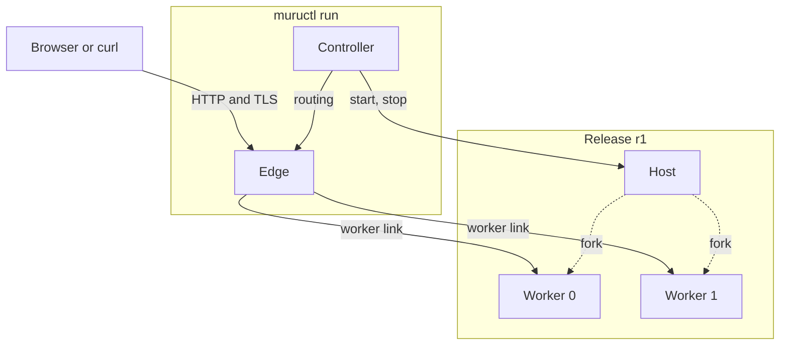
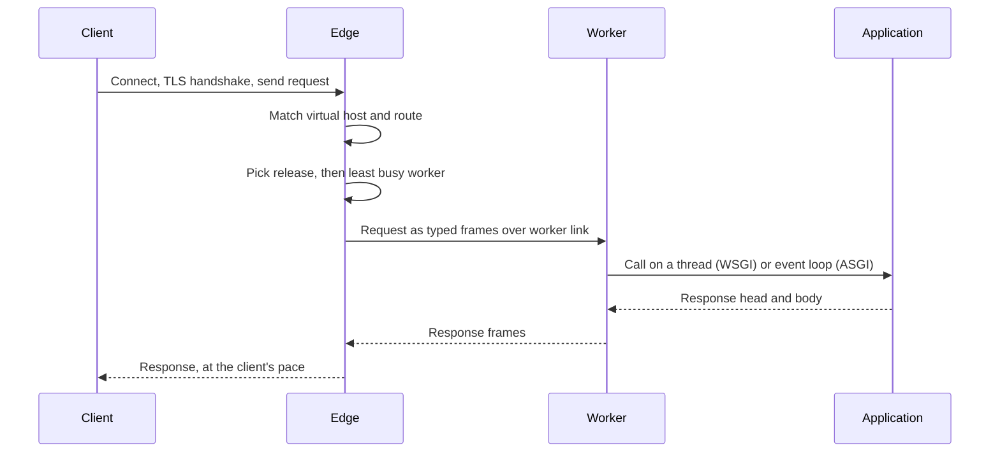
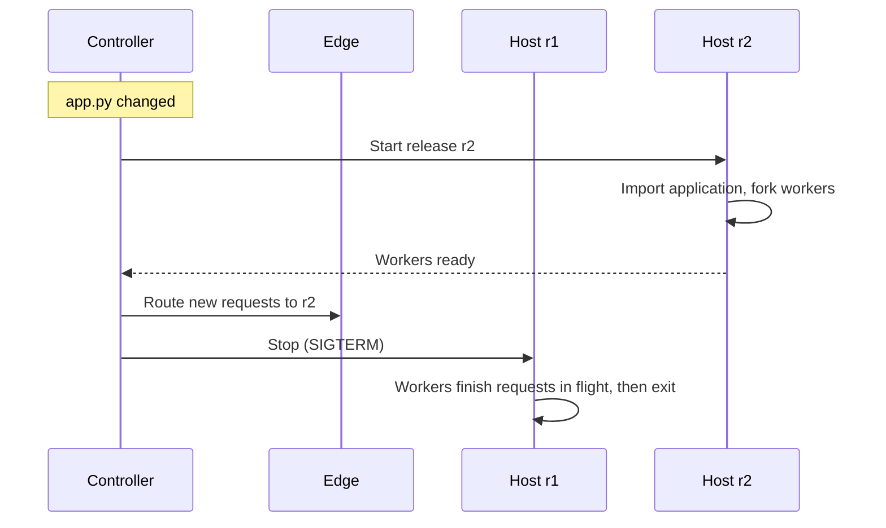
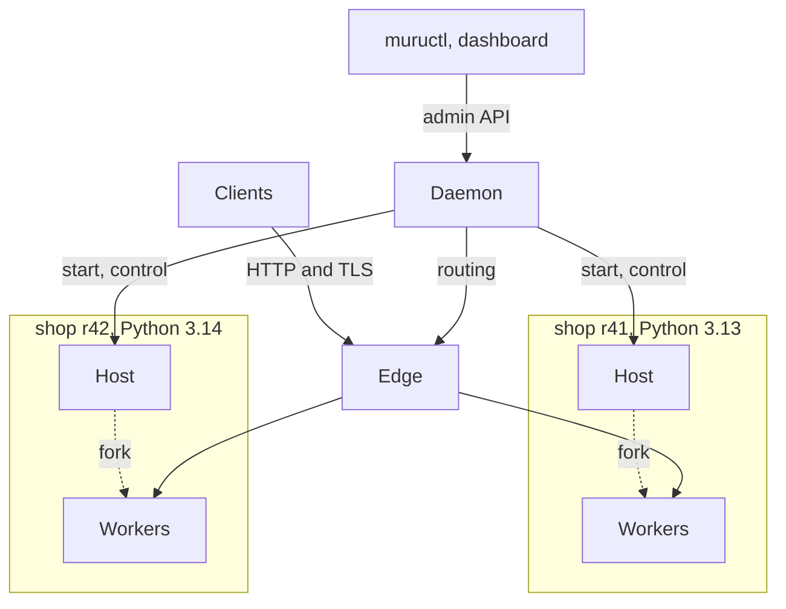

In [a first look at Muru](/posts/2026/11/a-first-look-at-muru/) and [looking inside the workers](/posts/2026/11/muru-looking-inside-the-workers/) I have been showing what Muru can do in development mode, without saying much about how it is put together. Words like host, worker, edge and release have kept turning up in the output, and I have mostly waved my hands at what they mean. Before going any further, it is time to explain what those parts are and how they fit together, since a lot of what makes Muru different follows from that design.

## The processes in a development run

When you run `muructl run` with two worker processes and look at the process tree, this is what you find:

```
59435     1 muructl run app:application --processes 2
59440 59435 .venv/bin/python -m muru.host --app app:application --release r1 --processes 2 --threads 4 ...
59443 59440 .venv/bin/python -m muru.host --app app:application --release r1 --processes 2 --threads 4 ...
59444 59440 .venv/bin/python -m muru.host --app app:application --release r1 --processes 2 --threads 4 ...
```

The `muructl` process started a Python process running `muru.host`. That host then forked the two workers, which is why they show the same command line as the host. There is no Python in the `muructl` process at all. It is a Rust program, and in development mode it contains two of Muru's main parts, the edge and the controller.



The edge is the part which faces clients. It accepts connections, handles TLS, speaks HTTP/1.1 and HTTP/2, works out where each request should go, and passes it on to a worker. It also deals with the things that don't need Python at all, such as serving static files, compressing responses and producing error pages. Because it is written in Rust and never runs any Python code, a slow request in your application can't hold it up.

The host is a Python process which imports your application once and forks workers from it, which I will look at more closely in the next post. It never serves requests itself. Its job is to make workers, and to replace them if they die.

The workers are where your application runs. Each one is a Python interpreter with your code already loaded, plus a small layer written in Rust which talks to the edge and hands requests over to your code, either on a thread for WSGI or on the event loop for ASGI.

The controller decides what should be running. It starts and stops hosts, tells the edge where to send traffic, and keeps track of releases. Importantly, it is never on the path a request takes.

## The path a request takes

Following a single request through the system shows how the work is divided up.



The edge reads the request and decides whether it is something it can answer itself, such as a static file or a redirect, or whether it needs to go to the application. If it does, the edge picks which release should handle it according to the traffic policy, then which worker within that release, choosing the one with the fewest requests already in flight. If every worker is busy, the request waits in a queue at the edge. That time spent waiting is the `queue` figure in the access log, which I made a point of back in [a first look at Muru](/posts/2026/11/a-first-look-at-muru/).

The request then crosses to the worker over what Muru calls the worker link, a connection over a Unix socket. What travels over it isn't HTTP. The edge has already parsed the request, so the method, path, headers and details about the connection are sent as small typed messages, followed by the request body as it arrives. Nothing gets turned back into HTTP text, only to be parsed all over again on the other side.

In the worker, your application sees exactly what it would under any other server. A WSGI application gets an ordinary `environ` dictionary, an ASGI application gets an ordinary scope. The response then flows back over the same link, with the worker gathering up small pieces of a response before sending them, so an application which yields a thousand tiny strings doesn't cause a thousand separate writes. The edge writes the response to the client at whatever pace the client can take it. If the client is slow, that slowness is passed back through the edge and the worker to the application, which waits with the interpreter released, so nothing ends up being buffered without limit along the way.

Request bodies are handled on demand in the same way. The edge only reads more of the body from the client as the application reads it, so an application which rejects a request without looking at the body doesn't cause a large upload to be read in for nothing. Where the application responds with a file, the edge sends it to the client straight from the file, rather than the contents being copied through the worker.

## What the extra hop costs

Anyone who has looked at how mod_wsgi daemon mode works will recognise the general shape here. There, the Apache child processes accept the connection and pass the request over a Unix socket to the daemon processes where the Python application runs. Muru does much the same, with a separate front end proxying requests to Python processes. The obvious question is what that costs compared with a server where Python reads the HTTP request directly off the socket.

The answer is one more copy of each byte, and some tens of microseconds of work per request, when both processes are on the same machine. Next to the time a typical Python web application spends handling a request, that is lost in the noise, and in return you get the edge doing all the client-facing work in Rust.

The bigger payoff though isn't performance. It is that the edge and the Python processes can come and go independently of each other. The edge can keep accepting connections while the application behind it is replaced. Workers can be recycled or restarted without dropping connections at the edge. More than one version of an application can be running at the same time, each on a different version of Python if need be. None of that is possible if the process handling the client connection is also the one running your Python code.

## A release is a unit you can swap

That brings things back to releases. A release is a fixed combination of application code, Python version and settings, together with the host and workers running it. Releases are never changed once started. If something needs to change, a new release is started.

That is what is happening when development mode reloads after you save a file. The controller doesn't restart anything. It starts a new release beside the current one, and only moves traffic across once the new release is ready.



If release `r2` never becomes ready, because the code fails to import for example, the step that changes the routing never happens, and `r1` keeps on serving as if nothing happened. That is what was going on in the first post when a broken import left the previous release serving.

Because moving traffic is just a change to the edge's routing, it doesn't have to be all or nothing either. The edge could just as easily send most requests to one release and a small share to another, or send particular clients to a preview of a new release. A reload in development mode is a straight switch, but the mechanism underneath is the same one used for blue/green deploys, canaries and rolling back.

## The same parts under the daemon

In development mode, the edge and the controller both live inside the one `muructl run` process, and there is only ever one application. Running on a server under the daemon, the same parts are arranged a bit differently.



The controller now lives in a long running daemon process, along with the admin API that `muructl` commands and the dashboard talk to, and a store which keeps track of what should be running. The edge runs as a separate process of its own. There can be many applications, and several releases of each running side by side, here with a new release of an application on a newer version of Python running beside the old one.

Keeping the daemon off the request path has a useful consequence. If the daemon is restarted or upgraded, the edge carries on serving requests using the routing it last received, and the hosts keep running. Replacing the edge is also handled without refusing connections, as the new edge process takes over the listening sockets from the old one. Traffic keeps flowing while the parts managing it are swapped out.

This is the part I most wanted to get right, given my history. Under Apache, the parent process owns the lifecycle of every child process, including the mod_wsgi daemon processes. Their number is fixed by the configuration, and changing anything significant means a restart of Apache, with everything that comes with it. With Muru, the thing that decides what should run is separate from the thing serving traffic, and both are separate from the Python processes. Each can be changed without disturbing the others.

The same model also applies when running in a container with `muructl serve`. There the edge, the controller, the host and its workers all run as the container's main process, much as in development mode, since a container is meant to run a single application.

## What's next

That covers how the parts fit together. The daemon, and deploying an application to a server with releases and traffic moving between them, will come once I have finished with development mode. Before that, in the next post I will go back to the host, and how Muru imports an application once and forks its workers from it, along with what it does to make sure that is safe.
