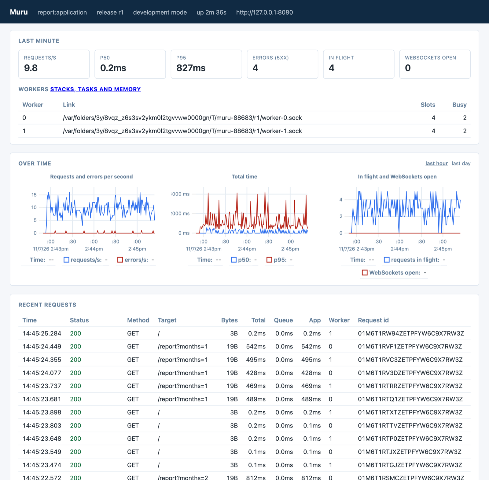

In [a first look at Muru](/posts/2026/11/a-first-look-at-muru/) I made a point of the access log separating how long a request waited for a worker from how long it spent in the application. That tells you where a slow request lost its time, but not why. Sooner or later the question you end up asking is what the workers are actually doing, usually because a request is taking far longer than it should.

The traditional answers to that are to guess, to sprinkle print statements and timing code through the application, or to bring in a separate monitoring product. Having spent twenty years on mod_wsgi seeing what people struggle with when hosting Python web applications, and five years at New Relic working on exactly this problem for Python, I have some fairly strong opinions about how much of this a hosting system should be able to tell you itself. Quite a lot, as it turns out, is the answer Muru gives.

## A slow report

To have something to look into, here is a small WSGI application with a deliberately slow report. Fetching the rows for the report pretends to wait on a database for a tenth of a second per month, and summarising them is pure Python arithmetic over eight million rows per month.

```python
import time
from urllib.parse import parse_qs


def fetch_rows(months):
    time.sleep(0.1 * months)  # as if waiting on a slow database query
    return range(8_000_000 * months)


def summarise(rows):
    total = 0

    for row in rows:
        total += row * row % 7

    return total


def build_report(months):
    rows = fetch_rows(months)
    return f"{months} months: {summarise(rows)}\n"


def application(environ, start_response):
    query = parse_qs(environ["QUERY_STRING"])
    months = int(query.get("months", ["1"])[0])

    if environ["PATH_INFO"] == "/report":
        body = build_report(months)
    else:
        body = "ok\n"

    start_response("200 OK", [("Content-Type", "text/plain")])
    return [body.encode()]
```

Rather than giving everything as options to `muructl run`, Muru can read its settings from a `[tool.muru]` table in the project's `pyproject.toml`. Here they name the entrypoint, ask for two worker processes, and also set a soft timeout of three seconds, which I will come back to shortly:

```toml
[tool.muru]
entrypoint = "report:application"
processes = 2

[tool.muru.timeouts]
soft_timeout = "3s"
```

Start it with `muructl run` and ask for reports covering one month and then three months. The access log shows what we would expect:

```
200 GET /report?months=1 19B 382ms queue=0.0ms app=382ms worker=0 id=01M6T02DPVG7XRY5V2P2V9S7WG
200 GET /report?months=3 19B 1.15s queue=0.0ms app=1.15s worker=1 id=01M6T02E30G7XRY5V2P2V9S7WG
```

The queue time is zero and the application time is all of it, so we know straight away the problem is in our code and not a lack of capacity. Three months taking over a second also means a year is going to be painful.

## Catching the worst case

By default a request in Muru can run for as long as it likes, up to a deadline at the edge of five minutes. Even when the edge gives up and answers the client, though, the request keeps going in the worker, tying up a thread for no benefit to anyone. That is what the soft timeout is for, and why I turned it on for this example.

Ask for twelve months, using JSON since that is easier to read here:

```
curl -H 'Accept: application/json' 'http://127.0.0.1:8080/report?months=12'
```

Three seconds later the response comes back:

```
{"type":"about:blank","title":"Gateway Timeout","status":504,"detail":"The request ran past the soft timeout of 3 s.","reason":"soft_timeout","request_id":"01M6T02F76G7XRY5V2P2V9S7WG","traceback":"..."}
```

When the request passed three seconds, a watchdog in the worker noted where the request was, then raised a `muru.RequestTimeout` exception in the thread running it. The exception unwound the report just like any other exception would, and Muru answered with a 504. The terminal says exactly where the request was when it was stopped:

```
muru.host[74087]: request.soft_timeout: worker 0 (pid 74088): request 01M6T02F76G7XRY5V2P2V9S7WG GET /report?months=12 ran past the soft timeout of 3 s at report.py line 14 in summarise, called from report.py line 21 in build_report, called from report.py line 29 in application
muru.worker[0]: Traceback (most recent call last):
muru.worker[0]:   File "/Users/graham/reports/report.py", line 29, in application
muru.worker[0]:     body = build_report(months)
muru.worker[0]:   File "/Users/graham/reports/report.py", line 21, in build_report
muru.worker[0]:     return f"{months} months: {summarise(rows)}\n"
muru.worker[0]:                                ~~~~~~~~~^^^^^^
muru.worker[0]:   File "/Users/graham/reports/report.py", line 14, in summarise
muru.worker[0]:     total += row * row % 7
muru.worker[0]:     ^^^^^
muru.worker[0]: muru.RequestTimeout
504 GET /report?months=12 638B 3.07s queue=0.0ms app=3.07s reason=soft_timeout worker=0 id=01M6T02F76G7XRY5V2P2V9S7WG
```

Only the one request was stopped, and the worker carried on serving others.

One detail worth knowing is that `muru.RequestTimeout` derives from `BaseException` and not `Exception`. A lot of application code catches `Exception` to log an error and carry on, and if the timeout were an `Exception` that code would swallow it and keep going. An application which does want to respond in its own way, such as telling the user to narrow down the date range, can still catch `muru.RequestTimeout` by name.

The soft timeout can only interrupt Python code. A thread stuck inside a C extension won't see the exception until the call returns. For that case there is also a hard timeout, which gives up on the whole worker and replaces it, but that is a topic for another time.

## Which requests are in flight

A timeout tells you about a request after the fact. Often what you want is to know what is running right now, and with more than one worker, the first thing to work out is which worker a slow request is running in. A six month report takes about two seconds, so start one in the background while a few one month reports are also being requested, and ask Muru what requests are in flight:

```
curl -s 'http://127.0.0.1:8080/report?months=6' &
muructl requests
```

```
RELEASE              GROUP        QUEUED  QUEUED-OLDEST  THREADS  THREAD-OLDEST
report@r1            default      0       -              5/8      1.2s
```

Under the daemon you would need to say which application to look at, but a development run only ever serves the one application. The `muructl` commands find the run by its admin socket when you run them from the project directory, so there is nothing more to type.

This first view counts the requests for each release. Nothing is waiting in the queue, five of the eight threads across the two workers are busy, and the oldest request has been running for 1.2 seconds. Adding `--list` shows each request, oldest first:

```
muructl requests --list
```

```
AGE      STATE    KIND            WORKER  REQUEST                                  CLIENT           REQUEST-ID
1.2s     running  wsgi            1       GET /report?months=6                     127.0.0.1        01M6T02SA1G7XRY5V2P2V9S7WH
0.5s     running  wsgi            0       GET /report?months=1                     127.0.0.1        01M6T02T18G7XRY5V2P2V9S7WJ
0.4s     running  wsgi            0       GET /report?months=1                     127.0.0.1        01M6T02T56G7XRY5V2P2V9S7WJ
0.3s     running  wsgi            0       GET /report?months=1                     127.0.0.1        01M6T02T94G7XRY5V2P2V9S7WJ
0.1s     running  wsgi            1       GET /report?months=1                     127.0.0.1        01M6T02TD2G7XRY5V2P2V9S7WJ
```

The six month report is the oldest, and it is running in worker 1.

Strictly speaking, this isn't looking inside the workers at all. The answer comes from the edge, which knows about every request it has passed to a worker, along with how long it has been running and which worker it went to. Nothing has to be asked of the workers to get it, so it costs them nothing, and it still answers even when a worker is too wedged to respond. That is why it is the first place to look. Once you know which worker a request is in, the more expensive tools can be pointed at just that worker.

There is an equivalent `muructl websockets` command for WebSockets, which aren't being used here. It counts the WebSockets open for each endpoint, and with `--list` shows each one, the longest open first.

## Seeing a request in progress

Knowing the six month report is in worker 1, the next step is to see what it is doing. Asking for the stacks of that worker:

```
muructl debug stacks --worker 1
```

Among the threads shown is the one serving the report:

```
muru-app-1 in worker 1:
  serving GET /report?months=6 for 1.3 s (request 01M6T02SA1G7XRY5V2P2V9S7WH)
  File "/Users/graham/Library/Caches/muru/runtime/0.1.0a18/cp315t/muru/_pool.py", line 30, in serve_jobs
    serve()
  File "/Users/graham/reports/report.py", line 29, in application
    body = build_report(months)
  File "/Users/graham/reports/report.py", line 21, in build_report
    return f"{months} months: {summarise(rows)}\n"
  File "/Users/graham/reports/report.py", line 14, in summarise
    total += row * row % 7
```

It shows which request the thread is handling, how long that request has been running, and where in the code it is at that moment. Leave off `--worker` and you get every thread in every worker instead, all without stopping anything.

How the stacks are obtained depends on the platform. On Linux with Python 3.15 or later, Muru reads the stacks from outside the worker process using the remote debugging support added by [PEP 768](https://peps.python.org/pep-0768/), so it works even if a worker is wedged in C code while holding the interpreter. On macOS, where reading another process needs root, the worker is asked to report its own stacks instead, which is what happened here.

## Where the time goes

A stack is a single moment in time. To know where the time goes overall, you want a profile, which samples the stacks repeatedly over a period and counts where they were. To get some load to profile, keep reports coming in another terminal:

```
while true; do curl -s 'http://127.0.0.1:8080/report?months=2' > /dev/null; done
```

and then profile the workers for ten seconds:

```
muructl debug profile --for 10s --output report.folded
```

```
808 samples of running Python code in 1632 rounds across 2 workers
   73.4%  summarise (report.py:10)
   26.6%  fetch_rows (report.py:5)
muru: collapsed stacks written to report.folded
```

Three quarters of the time is going on summarising the rows and a quarter on waiting for them, so a faster summary would be worth a lot more than a faster query. Being able to say that with evidence, rather than a hunch, is the whole point.

The file written out holds the collapsed stacks with their counts, which is the format flame graph tools expect, so `flamegraph.pl` can turn it into an SVG or you can open it in [speedscope](https://www.speedscope.app/) in a browser. If the application has many endpoints and only one of them is a problem, the profile can also be restricted to requests for a particular path.

Sampling every so often tells you proportions. If you want exact numbers instead, `muructl debug trace` counts every call of every Python function over a period, along with the time spent in each:

```
muructl debug trace --for 3s
```

```
worker 0 (pid 74088)
    total ms     calls  function
    1483.823         2  application (report.py:24)
    1483.674         2  build_report (report.py:19)
    1073.508         2  summarise (report.py:10)
     410.103         2  fetch_rows (report.py:5)
       0.095         2  parse_qs (parse.py:859)
       0.056         2  parse_qsl (parse.py:902)
       0.042         4  parse_qsl.<locals>._unquote (parse.py:937)
       0.031         4  unquote_plus (parse.py:983)
       0.014         4  unquote (parse.py:836)

worker 1 (pid 74089)
    total ms     calls  function
     736.969         2  application (report.py:24)
     736.857         2  build_report (report.py:19)
     531.764         2  summarise (report.py:10)
     410.168         2  fetch_rows (report.py:5)
       0.104         2  parse_qs (parse.py:859)
       0.064         2  parse_qsl (parse.py:902)
       0.048         4  parse_qsl.<locals>._unquote (parse.py:937)
       0.036         4  unquote_plus (parse.py:983)
       0.018         4  unquote (parse.py:836)
```

Tracing every call is a lot more expensive than sampling, so Muru will refuse to trace a worker which already has more than half of its threads busy with requests unless forced to with `--force`. The worker does keep serving while the trace runs though, since the requests it takes in that time are what the trace is measuring. Those requests are slowed down by the tracing, so this isn't something to leave running for long against an application people are using.

## Memory and running code

Slow requests aren't the only thing that goes wrong. Python web applications also have a habit of slowly growing in memory until something gives. Running `muructl debug memory` reports for each worker its memory use, the garbage collector's counts and the object types it holds most of. Adding `--trace` turns on `tracemalloc` for a period and reports the places in the code which allocated the most memory during that time, and there are options for taking a snapshot at one point and comparing against it later.

When all else fails, `muructl debug exec` will run a snippet of code inside the workers and print the result, which is handy for checking the state of some cache or other in a running process:

```
muructl debug exec -- 'import sys; sys.version'
```

```
worker 0 (pid 74088):
'3.15.1 free-threading build (main, Oct 21 2026, 17:44:52) [Clang 23.1.3 ]'
worker 1 (pid 74089):
'3.15.1 free-threading build (main, Oct 21 2026, 17:44:52) [Clang 23.1.3 ]'
```

Under the daemon this one is turned off unless explicitly allowed in the daemon's configuration, since it lets someone run arbitrary code inside a production application. In a development run it is always on, since the person at the terminal is the one who started the workers in the first place.

## Stopping at a breakpoint

All of the above is about looking at a worker from the outside. Sometimes though you really do want to stop in the middle of a request and poke around, and the usual way to do that in Python is a call to `breakpoint()`.

The catch is that with a normal development server, `breakpoint()` drops you into `pdb` on whatever terminal the server's output is going to, interleaved with log output from everything else. In Muru, a worker which hits `breakpoint()` instead waits for a debugger to attach, and the terminal tells you how to do that. Add a `breakpoint()` call to `build_report()` after the rows are fetched, save the file so it reloads, make a request, and the terminal shows:

```
muru.host[75915]: debug.breakpoint: worker 0 (pid 75918): breakpoint() at /Users/graham/reports/report.py:21 waits 60 s for muructl debug attach report --worker 0
```

The end of that line gives the command to run, which is `muructl debug attach report --worker 0`. Running it from another terminal opens a `pdb` session in the worker, at the point the request stopped:

```
muructl debug attach report --worker 0
```

```
muru: attached to worker 0 at /Users/graham/reports/report.py:21; the end of input lets the code go on
> /Users/graham/reports/report.py(21)build_report()
-> breakpoint()
(Pdb) p months
1
(Pdb) continue
muru: the session in worker 0 has ended
```

Typing `continue` lets the request carry on, and it completes as normal. While the session was open, the worker was taken out of routing so it wouldn't be given any new requests, leaving those to worker 1. The terminal records that, along with the worker being put back once the session ended:

```
muru.host[75915]: worker 0 (pid 75918) leaves routing while it is debugged
muru.host[75915]: debug.detached: worker 0 (pid 75918): the debugger session at /Users/graham/reports/report.py:21 ended
muru.host[75915]: worker 0 (pid 75918) serves again: no debugger is attached
200 GET /report?months=1 19B 2.28s queue=0.0ms app=2.28s worker=0 id=01M6T043M4G7XRY5V2P2V9S7WJ
```

The request was also exempt from the soft timeout, so it wasn't killed off while I was looking at it. If nobody attaches within the timeout, the request just carries on by itself.

For those who prefer to debug from an IDE, `muructl debug attach --dap` speaks the Debug Adapter Protocol instead, so something like VS Code can attach to the worker through `muructl`. That needs `debugpy` installed in the project's environment, and I will leave the details of that to the Muru documentation.

## The dashboard

Everything so far has been done from the command line. When you just want to keep an eye on things, the run also serves a dashboard, by default at `http://127.0.0.1:8081/`.



The top of the page shows the last minute at a glance, with requests per second, the 50th and 95th percentile latency, the count of server errors, how many requests are in flight and how many WebSockets are open. Below that is a table of the workers and how many of their threads are busy, charts of the same figures over time which can be switched to cover the last hour or the last day, the most recent requests with the same queue and application times as the access log, and the latest output from the run. A link from the workers table opens a page for each worker with its status, and the same stacks, tasks and memory figures the `muructl debug` commands give. In a development run there is no sign-in, and the dashboard is read-only, so nothing on it can change what the run is doing.

The same address also serves a `/metrics` endpoint in the Prometheus format, so if you do want to point some other monitoring system at a development run, you can.

## What's next

What I like about all this is that none of it required changing the application, installing an agent, or restarting anything, and all of it works the same way against an application running under the daemon in production. Along the way I have been talking about hosts, workers, the edge and admin sockets without really explaining them, so in the next post I will step back and look at how the parts of Muru fit together.
