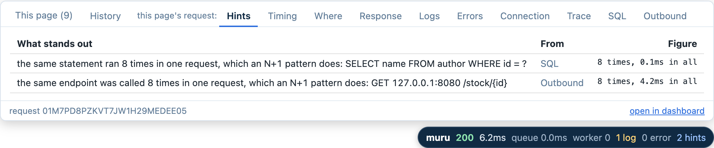
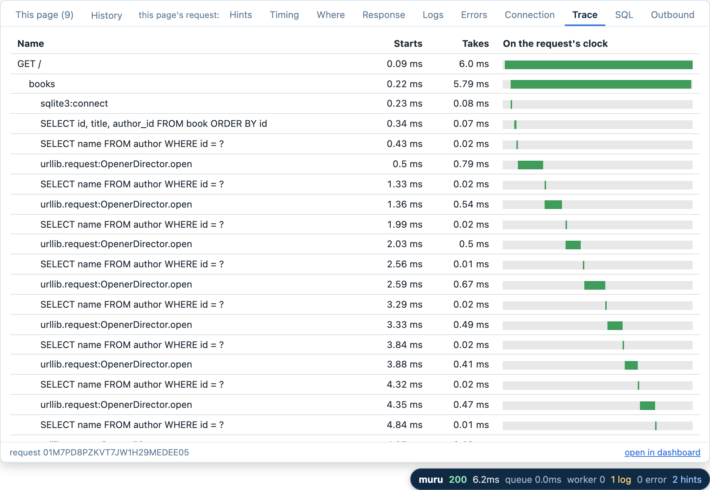
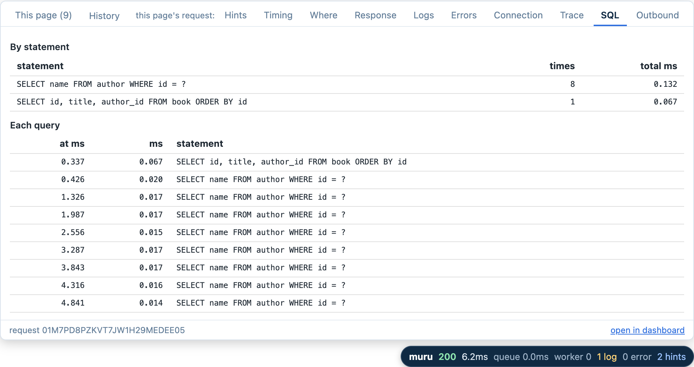
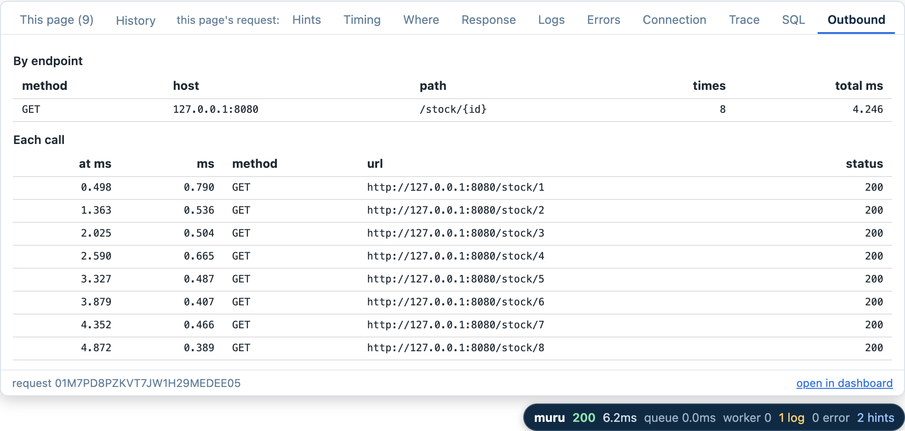
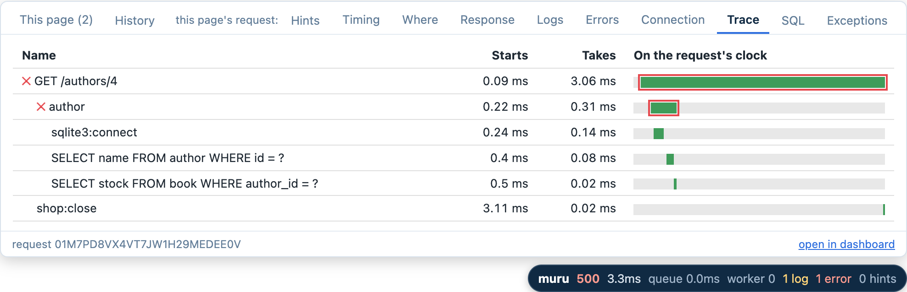

The [last post](/posts/2026/11/muru-a-toolbar-on-every-page/) was about the development toolbar Muru adds to each HTML page under `muructl run`, with the record Muru keeps of each request. That record can say a lot about how a request was served, how long it waited for a worker, how long the application took, what it logged and what went wrong. What it can't say is what the application did with its time, because Muru only sees the application from the outside.

For that, Muru uses [wrapture](https://wrapture.readthedocs.io/), the package I wrote for monkey patching, testing and tracing, which I covered in a [series of posts](/guides/testing-and-tracing-with-wrapture/) earlier this year. With tracing turned on, wrapture's instrumentation records the calls the application makes while it serves a request, such as its database queries and calls to other services, and the toolbar gains panels showing them.

## Turning tracing on

The shop from the last post is a Flask application which uses `sqlite3` for its database, and `urllib.request` to call its stock service. Tracing needs wrapture and its instrumentation packages added to the project:

```
$ uv add wrapture wrapture-instrumentation
```

then `tracing = true`, and a wrapture configuration saying what to instrument, which can go in the same `pyproject.toml`:

```toml
[tool.muru]
entrypoint = "shop:app"
tracing = true

[tool.muru.run]
toolbar = true

[[tool.wrapture.instrument]]
name = "flask"

[[tool.wrapture.instrument]]
name = "sqlite3"
statement = true

[[tool.wrapture.instrument]]
name = "urllib.request"
```

The `flask` instrumentation records each request with the view that handled it, `sqlite3` records each query, with `statement = true` so the SQL itself is kept, and `urllib.request` records calls made with it. The configuration can also be in a `wrapture.toml` file beside `pyproject.toml`, or a file named by `WRAPTURE_CONFIG`, which is where wrapture itself would look for it. I have also put `toolbar = true` in the `[tool.muru.run]` table this time, so the toolbar is on without needing `--toolbar` each time.

When the run starts, the host says where the configuration came from and what it instruments:

```
muru.host[36012]: tracing on: wrapture configuration from [tool.wrapture] in ./pyproject.toml, instrumenting flask, sqlite3, urllib.request
```

Not everyone working on a project may want tracing on, since it adds work to every request. `tracing = true` in the `muru.local.toml` beside the project turns it on for my own runs only, with the configuration still coming from the project. Tracing needs Python 3.12 or later, and if wrapture is missing, or its configuration can't be found or applied, the run logs a one-line warning saying why and serves the application untraced, rather than failing to start.

## What the front page does

With tracing on, the front page's badge now shows two hints, and the toolbar opens on them:



The toolbar also has new tabs, Trace, SQL and Outbound. The Trace panel is the request's tree of operations, on the same clock as the Timing panel from the last post:



The view ran one query for the books, and then for each book, a query for its author and a call to the stock service. This is the code which did that:

```python
@app.route("/")
def books():
    rows = database().execute("SELECT id, title, author_id FROM book ORDER BY id").fetchall()
    books = []

    for book_id, title, author_id in rows:
        query = "SELECT name FROM author WHERE id = ?"
        (author,) = database().execute(query, (author_id,)).fetchone()
        stock = in_stock(book_id)

        if stock == 0:
            log.warning("%s is out of stock", title)

        books.append({"id": book_id, "line": f"{title} by {author}, {stock} in stock"})

    return render_template_string(PAGE, title="Books", books=books)


def in_stock(book_id):
    with urllib.request.urlopen(f"{request.host_url}stock/{book_id}") as response:
        return int(response.read())
```

Nothing about it looks wrong when reading it, and with eight books, the whole page took under ten milliseconds. It is a different story with a thousand books, a database on another machine, and a stock service on the other side of a network.

## Queries and calls, grouped

The Trace panel shows the pattern when there are only a few books, but with hundreds it would be a very long list. The SQL panel groups the request's queries by statement, with how many times each ran and their total time, and then lists each query in order:



Statements which differ only in the values written into them group together, so the author query shows up as one statement run eight times. This is the N+1 pattern, one query for the list and then one more for each row of it, and it is one of the most common performance problems in web applications which use a database. It is also easy to write without noticing, since an ORM will happily generate it from code that looks perfectly reasonable.

The Outbound panel does the same for calls to other services, grouped by method, host and path:



A path segment which names a row rather than the endpoint, such as a number, a UUID or a long hexadecimal string, is grouped as `{id}`, so the eight calls to `/stock/1` through `/stock/8` are one endpoint called eight times. Calls made with `requests`, `httpx`, `urllib3`, `aiohttp` and `http.client` are recorded the same way, given the instrumentation for them, as are gRPC calls.

The fix for both is to ask for everything at once. A join gets the authors with the books, and the stock service can answer for several books in one call:

```python
@app.route("/")
def books():
    query = (
        "SELECT book.id, book.title, author.name FROM book"
        " JOIN author ON author.id = book.author_id ORDER BY book.id"
    )
    rows = database().execute(query).fetchall()
    stock = in_stock([book_id for book_id, _, _ in rows])
    books = []

    for book_id, title, author in rows:
        if stock[book_id] == 0:
            log.warning("%s is out of stock", title)

        books.append({"id": book_id, "line": f"{title} by {author}, {stock[book_id]} in stock"})

    return render_template_string(PAGE, title="Books", books=books)


def in_stock(book_ids):
    ids = ",".join(str(book_id) for book_id in book_ids)

    with urllib.request.urlopen(f"{request.host_url}stock?ids={ids}") as response:
        return {int(book_id): count for book_id, count in json.load(response).items()}
```

Saving the file was enough for the run to start a new release with the change:

```
muru: reloading, /Users/graham/shop/shop.py changed
muru: switched to release r2
```

and the front page's record now has one query and one call:

```
$ muructl debug request 01M7PBFZP78AN9K8YRZ0DC3AMY
...
SQL
  By statement
    SELECT book.id, book.title, author.name FROM book JOIN author ON author.id = book.author_id ORDER BY book.id  1  0.098
  Each query
    0.419  0.098  SELECT book.id, book.title, author.name FROM book JOIN author ON author.id = book.author_id ORDER BY book.id

Outbound
  By endpoint
    GET  127.0.0.1:8080  /stock  1  0.991
  Each call
    0.604  0.991  GET  http://127.0.0.1:8080/stock  200
```

The two hints went with them. Hints are where I would start with any page, since they apply the same thresholds to every request without me having to remember what to look for. A statement run five or more times in one request, or an endpoint called five or more times, is flagged, as is a single query or call taking a quarter or more of the request's time and at least 10 milliseconds.

## The failing page again

The author page from the last post still divides by zero for an author with no books. With tracing on, its Trace panel shows where the exception went:



The view, `author`, is marked as failed, since the exception escaped it. The request is marked as well, because Flask's instrumentation notes the exception Flask's error handling caught against the request. The Exceptions panel lists both, the one Flask handled being marked as such:

```
GET /authors/4  ZeroDivisionError: division by zero (handled)
author          ZeroDivisionError: division by zero
```

The bars also show something the Errors panel didn't. The view itself was done in about a third of a millisecond, out of a request which took about three. Most of the rest went on Flask handling the exception, which includes formatting and logging the traceback.

## Applications without framework instrumentation

The shop gets its request spans from the `flask` instrumentation, and there is the same for Django and other frameworks. An application without such instrumentation, such as a plain WSGI or ASGI callable, can have Muru wrap its entry point in wrapture's request middleware instead:

```toml
[tool.muru]
entrypoint = "api:application"
tracing = true
tracing_middleware = true
```

The same key in a mount's table wraps just that mount, for an application which [mixes WSGI and ASGI](/posts/2026/11/muru-wsgi-and-asgi-together/). It shouldn't be used where a framework's instrumentation already records requests, since the middleware would then record them instead, and the framework's own request settings would no longer apply.

## Tracing and the workers

How tracing is set up follows from how Muru starts an application, as covered in the [import once, fork many](/posts/2026/11/muru-import-once-fork-many/) post. The host process applies the wrapture configuration before it imports the application, so the instrumentation's patches are in place for the application's own imports. What the configuration sends events to, its sinks, are only started in each worker after it is forked, so the host holds no threads or open files of wrapture's when it forks.

The toolbar's panels don't need a sink at all, since Muru collects what wrapture records for each request itself. Any sinks the configuration does declare still work as they would without Muru. Adding wrapture's printer sink, for example, prints each request's tree in the run's output, from the worker which served it:

```
muru.worker[0]: GET /authors/1 (shop.wsgi_app)
muru.worker[0]:   author(author_id=1)
muru.worker[0]:     sqlite3:connect('<str>')
muru.worker[0]:     sqlite3:connect -> '<Connection>' [220us]
muru.worker[0]:     sqlite3:Connection.execute(sql='<36 chars>', parameters='<1 values>')
muru.worker[0]:     sqlite3:Connection.execute -> '<Cursor>' [136us]
muru.worker[0]:     sqlite3:Connection.execute(sql='<42 chars>', parameters='<1 values>')
muru.worker[0]:     sqlite3:Connection.execute -> '<Cursor>' [26us]
muru.worker[0]:     flask:render_template_string(source='<!doctype html>\n<html>\n<head><title>{{ name }}</title></h...', context='<context>')
muru.worker[0]:     flask:render_template_string -> '<191 chars>' [1.3ms]
muru.worker[0]:   author -> '<str 191 chars>' [2.0ms]
muru.worker[0]:   shop:close(exc=None)
muru.worker[0]:   shop:close -> None [27us]
muru.worker[0]: shop.wsgi_app -> '200 OK' [4.4ms, body 6us over 1 chunk]
```

Each worker writes its own output, so a sink writing to a file needs `{pid}` in its path to give each worker a file of its own.

The same is true under `muructl serve` and the Muru daemon, except there is no toolbar there, so tracing costs only what the configuration's own sinks do. In production that would normally mean exporting to an OpenTelemetry collector, as covered in the [OpenTelemetry export in wrapture](/posts/2026/09/opentelemetry-export-in-wrapture/) post.

## What's next

Between them, the toolbar and tracing answer most of what I want to know about a request while I'm working on an application. How long it waited and why, what it logged and what failed, and what the application did with its time, all without adding anything to the application beyond a dependency and a few lines of configuration.

The toolbar's Timing panel has one more row, for modules a request loads for the first time in its worker, and that is where the next post, when lazy imports help, picks up. Lazy imports are popular for making command line tools start faster, but in a web server which imports an application once and forks its workers, deferring an import is a trade, and Muru has the measurements to make it.
