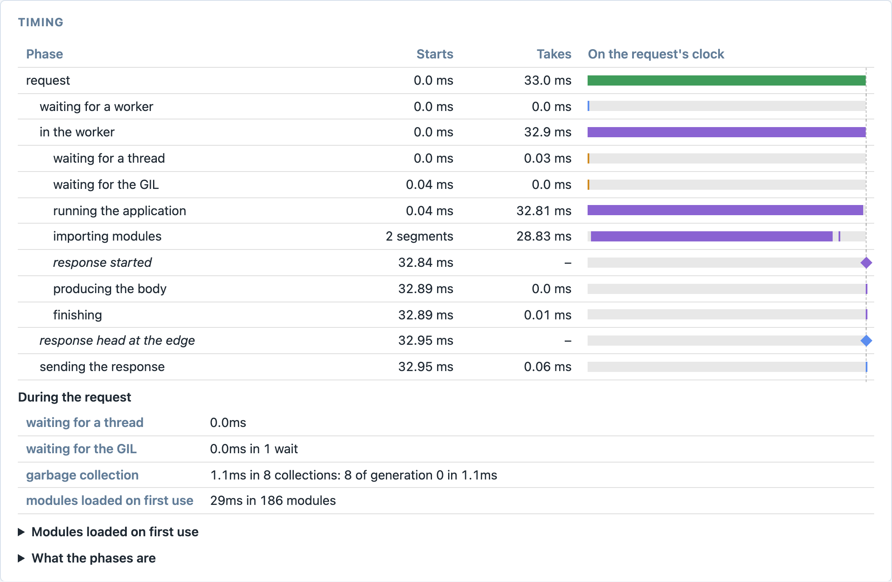

Lazy imports are having a moment. Python 3.15 adds a `lazy import` statement, from [PEP 810](https://peps.python.org/pep-0810/), and a module can name imports it wants deferred in a `__lazy_modules__` list. A deferred import binds its name straight away, but the module isn't loaded until the code first uses it. Most of the excitement is about command line tools. A tool which imports everything it might ever need, just to print its `--help`, can start in a fraction of the time when most of those imports are deferred.

A web application served by a pre-forking server is a different calculation, and deferring imports there can make things worse rather than better. Whether it helps depends on the application, on how it is deployed, and on what its requests actually use, which is why Muru measures imports rather than leaving it to guesswork.

## Where import time goes under Muru

As covered in the [import once, fork many](/posts/2026/11/muru-import-once-fork-many/) post, Muru imports an application once in a host process, and forks the workers from it. Everything the host imported is shared by the workers through copy on write memory, and is paid for once.

Under the Muru daemon, a deploy starts a new release beside the one serving, as covered in the [releases, not restarts](/posts/2026/11/muru-releases-not-restarts/) post, and traffic only moves to it once it is ready. However long the new release takes to import the application, nobody visiting the site waits for it. Deferring an import doesn't save anyone any time there. What it does is move the cost into the first request in each worker which uses the module, and since each worker then loads the module itself, its memory is no longer shared.

Under `muructl serve` in a container, a new release is a new container, and the import is part of how long it takes to start. A shorter start makes a rollout or a scale-out finish sooner. Even so, as covered in the [working with Kubernetes](/posts/2026/11/muru-working-with-kubernetes-not-around-it/) post, Muru's readiness probe doesn't pass until the application is loaded and the workers are ready, so a new pod still gets no requests before it can serve them.

There are times when someone does wait for the import. A release [scaled to zero](/posts/2026/11/muru-scaling-to-zero/) with its host stopped makes the next request wait for the host to start and import the application. And `muructl run` in development loads the application again every time a file changes.

So a deferred import can help or hurt, depending on how the application is run and how often its requests use what was deferred. To decide, it helps to know what each import costs, and what the workers end up loading anyway.

## A shop with two slow imports

The example for this post is a small Flask shop with two features that need large libraries. A stock report uses pandas:

```python
# shop/reports.py
import pandas

from shop.data import BOOKS


def stock_value():
    frame = pandas.DataFrame(BOOKS, columns=["title", "author", "stock", "price"])
    frame["value"] = frame["stock"] * frame["price"]
    return frame.groupby("author")["value"].sum().to_string()
```

and a download of the stock list as a spreadsheet uses openpyxl:

```python
# shop/export.py
import io

import openpyxl

from shop.data import BOOKS


def workbook():
    book = openpyxl.Workbook()
    ...
```

Someone has already tried to keep start-up fast, so the view for the report imports `shop.reports` inside the function, while `shop.export` is imported at the top of the application's module like everything else:

```python
from flask import Flask, Response, render_template_string

from shop import export
from shop.data import BOOKS

app = Flask(__name__)

...

@app.route("/report")
def report():
    from shop import reports

    return render_template_string(REPORT, report=reports.stock_value())
```

It runs under `muructl run` with two worker processes, on Python 3.14.

## What the host's load costs

Muru can record every import the host makes while it loads the application, using the profile recorder of [unwrapt](https://unwrapt.readthedocs.io/), a package for lazy imports which I wrote alongside Muru. With unwrapt added to the project's dependencies, `import_report` turns it on:

```toml
[tool.muru]
entrypoint = "shop.app:app"
import_report = true
```

`muructl debug imports` then prints a report of the host's load:

```
$ muructl debug imports
Import report of the host's load of shop@r1: outcome fork, Python 3.14.8, 2 workers
  113.8 ms importing, 397 modules loaded, 4046 import calls; deferring what can be deferred would save about 75.2 ms

Advice
  defer: shop imported by shop.app, 71.2 ms, loading entrypoint
    paid by the host, once before the fork, shared by the 2 workers; deferred, each worker that uses it loads it on first use
    add 'shop' to __lazy_modules__ in shop.app; it defers natively from Python 3.15, and below it only once rewritten as import shop (from-import)
      __lazy_modules__ = ['shop']
  defer: openpyxl imported by shop.export, 70.9 ms, loading entrypoint
    paid by the host, once before the fork, shared by the 2 workers; deferred, each worker that uses it loads it on first use
    add 'openpyxl' to __lazy_modules__ in shop.export
      __lazy_modules__ = ['openpyxl']

Imports that loaded a module, by cumulative time
  CUM MS SAVES MS IMPORTED IMPORTED BY         LOADING    3.15 UNWRAPT NOTES
    71.2      0.0 shop     shop.app            entrypoint yes  no
    70.9     70.9 openpyxl shop.export         entrypoint yes  yes
     5.0      0.0 click    flask.app           entrypoint yes  yes     also imported eagerly by flask.cli
     0.8      0.8 html     http.server         entrypoint yes  yes
     0.7      0.0 decimal  flask.json.provider entrypoint yes  yes     also imported eagerly by openpyxl.compat.numbers
  126 more rows with nothing to act on; --all lists them

The 2 workers that answered have loaded no module for the first time since the fork.
```

Most of the load was openpyxl. The advice for each import says what deferring it would mean, and the configuration to write. For the shop's own code, that is a `__lazy_modules__` list in the module making the import. For an import inside a package the project depends on, where nobody wants to edit the package's source, it is an entry of unwrapt's `[tool.unwrapt.lazy_modules]` table, naming the importing module and what to defer in it.

The first piece of advice is about the application's own `from shop import export`, and nearly all of its 71.2 milliseconds is the openpyxl which `shop.export` imports, so the two are different ways of deferring the same cost. The 3.15 and UNWRAPT columns say whether each way of deferring can defer that import as written, since Python 3.15 can defer a `from` import while unwrapt can only defer a plain `import`. On the Python 3.14 the shop runs on, deferring the `from` import would save nothing unless it were rewritten, which is why its SAVES column is zero.

The report lists by default only the imports there is something to do about. With `--all` it lists the rest, among them the numpy which openpyxl imports in turn, for 28.6 of openpyxl's milliseconds:

```
  CUM MS SAVES MS IMPORTED IMPORTED BY             LOADING    3.15 UNWRAPT NOTES
    28.6      0.0 numpy    openpyxl.compat.numbers entrypoint yes  yes     used at load, deferring saves nothing, ...
```

It isn't advised, because `openpyxl.compat.numbers` uses numpy at the top level, straight after importing it, to build a tuple of numeric types. A deferred import that is used the moment it is made is loaded straight away anyway, so deferring it would save nothing.

The same report comes from `muructl check --imports`, which loads the application once without serving anything, so it can be run before and after a change, or in CI.

## Deferring an import

The spreadsheet export is used rarely, so deferring openpyxl looks worthwhile. That takes two changes. The module names the import in `__lazy_modules__`, before the import itself:

```python
# shop/export.py
__lazy_modules__ = ["openpyxl"]

import io

import openpyxl
```

and the project turns on `lazy_imports`:

```toml
[tool.muru]
entrypoint = "shop.app:app"
import_report = true
lazy_imports = true
```

Python 3.15 and later act on `__lazy_modules__` by themselves. Python 3.11 to 3.14 ignore it, and with `lazy_imports` on, Muru has unwrapt defer the imports it names instead, so the same code defers on every version of Python Muru supports. The `lazy import` statement can't be used that way, since it is a syntax error before 3.15.

As the host forks, it says what was deferred, and whether anything used a deferred import before the fork anyway, in which case deferring it saved nothing:

```
muru.host[74803]: lazy_imports: 1 import deferred, none of them used before the fork
```

How much this saved needs more than one measurement, since a load's time varies from one start to the next by about as much as the difference being measured. A `muru.local.toml` beside the project overrides the project's settings for my own runs only, so `lazy_imports = false` in it turns deferral off without changing `pyproject.toml`. With `import_report = false` there as well, since recording the imports adds to the load, I started the run five times each way. The host took a median of 83 milliseconds to load the application without deferral, and 35 milliseconds with it.

The cost hasn't gone away though, it has moved. The first request for the spreadsheet in a worker now loads openpyxl, and the numpy it imports in turn:

```
server-timing: queue;dur=0.00, app;dur=56.89, import;dur=52.03, muru;desc="01M7TS44DGPY87CQSBXYXS7D83"
```

The `import` entry in `Server-Timing` is the time the request spent loading modules for the first time in its worker. The request's Timing panel, on the dashboard here since a spreadsheet has no page for the toolbar, shows it as an "importing modules" row, and its list of the modules loaded marks the one that resolved a deferred import, with the line of code that first used it:



```
  Modules loaded on first use
    encodings.idna  0.7ms  1.0ms  encodings/__init__.py:100
      stringprep  1.0ms  0.3ms  encodings/idna.py:3
    openpyxl (deferred)  2.1ms  50ms  shop/export.py:11
      openpyxl.compat  2.3ms  21ms  openpyxl/__init__.py:5
        openpyxl.compat.numbers  2.4ms  21ms  openpyxl/compat/__init__.py:3
          numpy  2.5ms  21ms  openpyxl/compat/numbers.py:9
...
```

Line 11 of `shop/export.py` is `book = openpyxl.Workbook()`, the first use of the module.

Since numpy was a good part of that, I tried deferring it inside openpyxl anyway, to see what the report's reason for not advising it looks like in practice, with an entry of `[tool.unwrapt.lazy_modules]`:

```toml
[tool.unwrapt.lazy_modules]
"openpyxl.compat.numbers" = ["numpy"]
```

The list of modules for the next first download showed `numpy (deferred)` being loaded from line 16 of `openpyxl/compat/numbers.py`, while openpyxl itself was still loading. That is the line which builds the tuple of numeric types, so the deferred import was used the moment it was made. The workers' part of `muructl debug imports`, which comes up next, said the same of it, "used as openpyxl.compat.numbers loads, at openpyxl/compat/numbers.py:16; deferring it saves nothing, remove the entry", so I took the entry out again.

## Asking the workers

Whether moving that cost was worth it depends on how many workers end up paying it, and that depends on the traffic. After the run had served some pages, several stock reports and one spreadsheet, the last part of `muructl debug imports` asked each worker what it had loaded for the first time since the fork:

```
Modules loaded for the first time since the fork, by the 2 workers that answered
  MODULE                      LOADED BY FIRST REQUEST                 MS ADVICE
  shop.reports                2 of 2    01M7TS5XN33J2YHXVA5EYVR7RN 134.0 every worker loads it: load it before the fork with preload_modules = ["shop.reports"]
  openpyxl (deferred)         1 of 2    01M7TS5XV33J2YHXVA5EYVR7RX  28.7 deferred in the host; loaded by 1 of 2 workers: loading on first use pays off: only some workers load it
  encodings.idna              2 of 2    01M7TS5XMM3J2YHXVA5EYVR7RM   1.4 every worker loads it: load it before the fork with preload_modules = ["encodings.idna"]
  openpyxl.packaging.extended 1 of 2    01M7TS5XV33J2YHXVA5EYVR7RX   0.1 loading on first use pays off: only some workers load it
  The counts cover the requests served so far; read them after representative traffic.
```

The two features come out on opposite sides. Only one worker had needed openpyxl, so the other was spared both the time and the memory, and the deferral paid off. Every worker had needed `shop.reports`, and each loaded pandas itself, about 135 milliseconds a time, which the function level import in the view had pushed into the first report each worker served.

That first report is also worse than it looks. With three requests for the report sent at once, two of them went to the same worker on different threads, and both took about 140 milliseconds. Only one of them was loading pandas. The other was waiting on Python's import lock for it to finish, and their `Server-Timing` headers tell the two apart:

```
server-timing: queue;dur=0.01, app;dur=140.39, import;dur=137.67, muru;desc="01M7TS5YW93J2YHXVA5EYVR7RZ"
server-timing: queue;dur=0.40, app;dur=140.80, import_wait;dur=138.92, muru;desc="01M7TS5YW93J2YHXVA5EYVR7S2"
```

The second request's Timing panel has a "waiting for an import" row in place of "importing modules", and names the module and the request it was waiting on:

```
waiting for an import: 139ms in 1 wait: shop.reports, loaded by request 01M7TS5YW93J2YHXVA5EYVR7RZ
```

The first requests after a deploy, or after a scale-out adds workers, are exactly when that happens.

## Loading before the fork

A module that every worker loads is better loaded once, in the host, before the fork. `preload_modules` lists modules for the host to import after the application, as part of the same load:

```toml
[tool.muru]
entrypoint = "shop.app:app"
import_report = true
lazy_imports = true
preload_modules = ["shop.reports"]
```

The host's load now includes pandas, and the first reports in each worker took from four and a half to nine milliseconds, rather than more than a hundred. The import report gives the entry's own cost on a line of its own, `preload_modules entry shop.reports: 145.5 ms in the host`, and doesn't advise deferring anything the entry loads, since that would only undo it.

`preload_modules` is also the way to undo a deferral you don't want. Once Python 3.15 is common, libraries will start using `lazy import` themselves, for their own command line tools or their own start-up time, and in a web application that may move a library's import into the first request of each worker. Listing the module in `preload_modules` loads it before the fork regardless, and the deferred import finds it already loaded when the code first uses it.

## After more traffic

The advice is only as good as the traffic the workers have seen. After a few more downloads of the spreadsheet, both workers had served one:

```
Modules loaded for the first time since the fork, by the 2 workers that answered
  MODULE                      LOADED BY FIRST REQUEST                MS ADVICE
  openpyxl (deferred)         2 of 2    01M7TS6PYFJQCRT78JGT5BYKRS 31.1 deferred in the host; loaded by 2 of 2 workers: load it before the fork with preload_modules = ["openpyxl"]
  encodings.idna              2 of 2    01M7TS6CHTJQCRT78JGT5BYKRE  1.6 every worker loads it: load it before the fork with preload_modules = ["encodings.idna"]
  openpyxl.packaging.extended 2 of 2    01M7TS6PYFJQCRT78JGT5BYKRS  0.1 every worker loads it: load it before the fork with preload_modules = ["openpyxl.packaging.extended"]
  The counts cover the requests served so far; read them after representative traffic.
```

With two workers running for a long time, a module that any request uses at all eventually ends up loaded in all of them, at which point the deferral bought nothing but a slower first request in each. With more workers, workers that are replaced after a number of requests, or an autoscaler which adds and removes workers as load changes, many workers may never get as far as needing it. Which of those describes a production deployment is something only its own traffic can say, so this is a question to ask of a running release rather than a development run. The same counts are kept as metrics, `muru_worker_modules_loaded_total` and `muru_worker_module_load_seconds_total`, so they can be watched over time.

## What's next

Lazy imports are a useful tool, but in a web application served by a pre-forking server they are a trade between the host's load, the first request in each worker, and how much memory the workers share. Muru gives you the measurements to make that trade for your own application. The `Server-Timing` header and the Timing panel show what a request paid for imports, the import report shows what the host's load costs and where to cut it, and the workers say what they ended up loading anyway. Deferral through unwrapt works the same from Python 3.11 to 3.15, and `preload_modules` puts back what shouldn't have been deferred.

The next post, working with coding agents, is about something else doing things through Muru. Coding agents are increasingly the ones running, deploying and debugging applications, and Muru gives them a way in through MCP, so an agent can deploy each change as a release, read the events, logs and worker stacks when something fails, and roll back, using everything the earlier posts covered.
